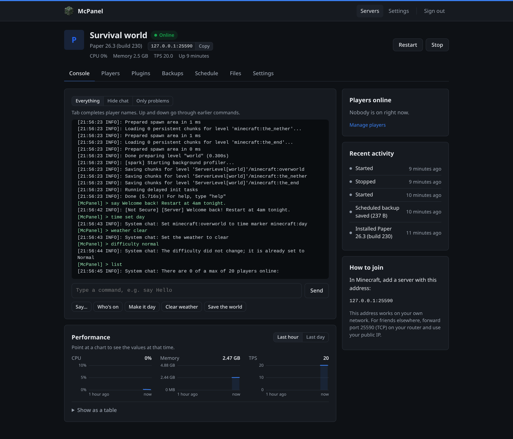
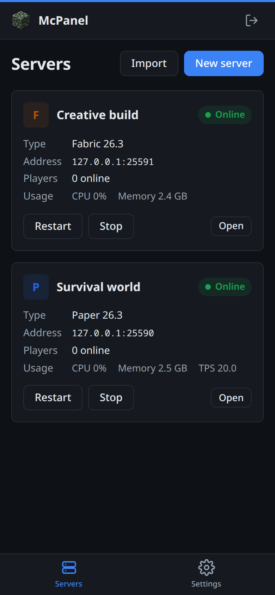
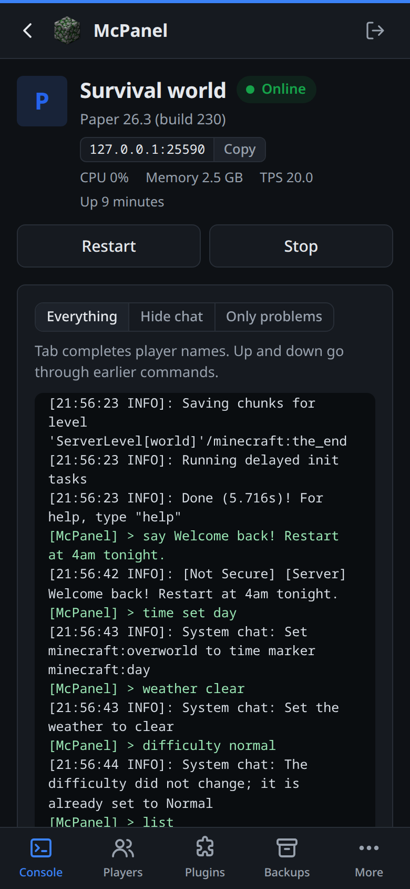
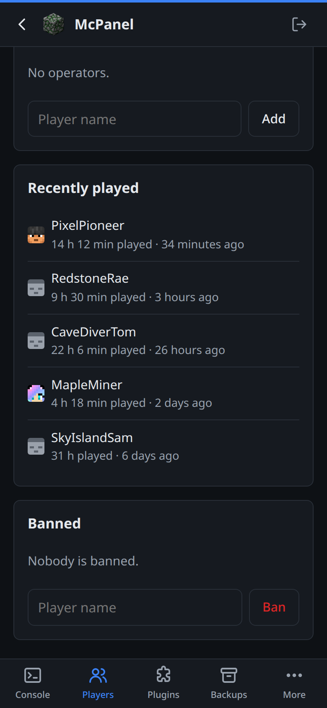
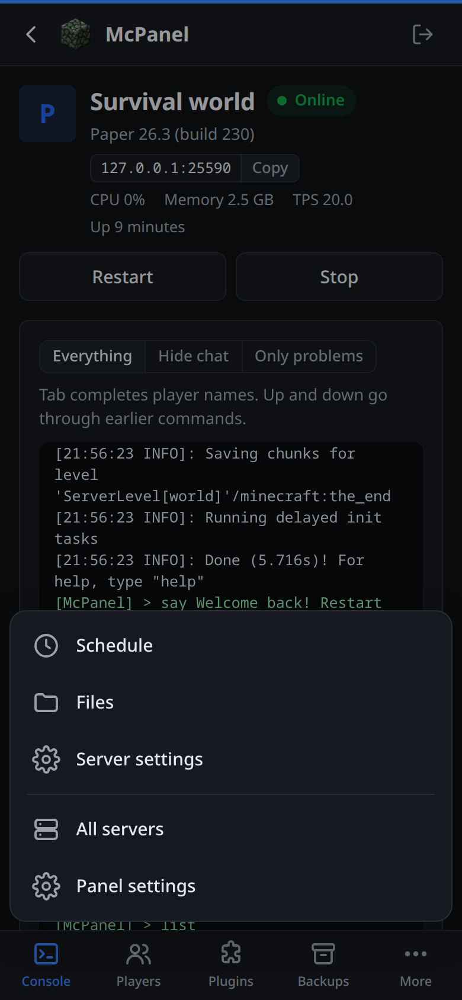
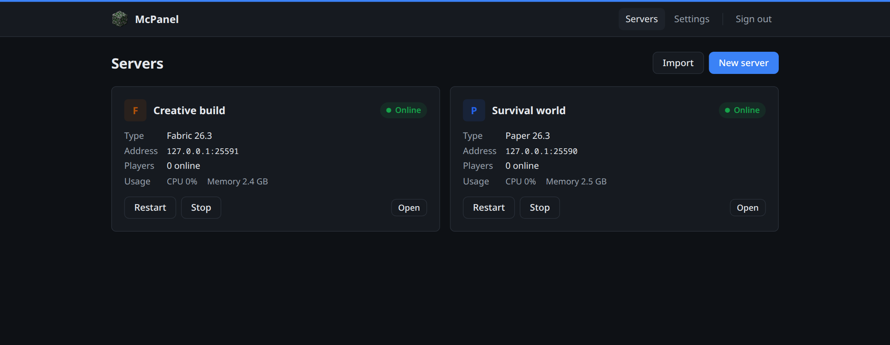
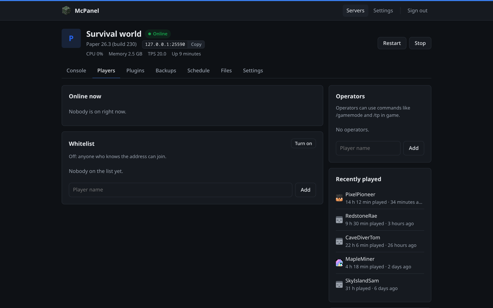
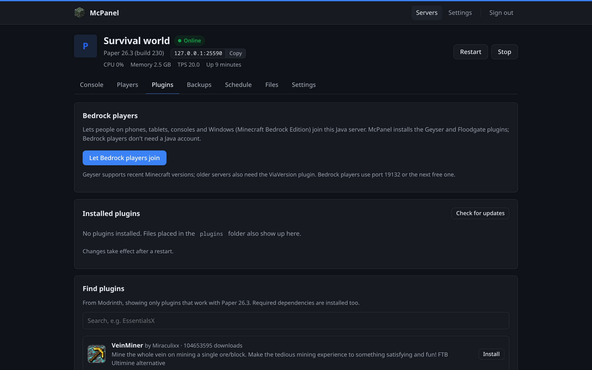
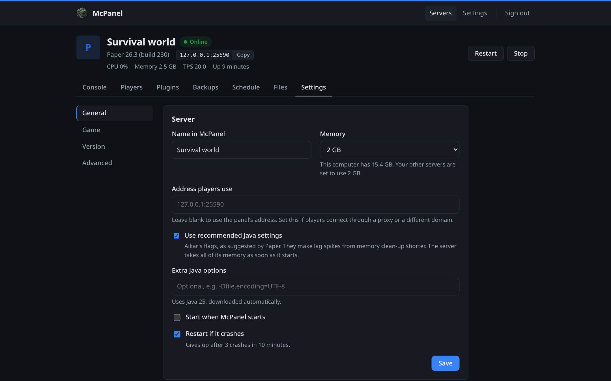

# McPanel

A simple, self-hosted web panel for running Minecraft servers. It downloads the
server software and the right Java version for you, then lets you start, stop,
configure and back up your servers from one page.

<p align="center">
  
</p>

<p align="center">
  
  
  
  
</p>

<details>
<summary>More screenshots</summary>






</details>

## Features

- Paper, Vanilla, Fabric and Bedrock servers; Java is downloaded automatically
- Live console with quick buttons, Tab to complete player names, saved
  command history, and a filter to hide chat or show only problems
- CPU, memory and (on Paper) TPS charts for the last hour or day
- Settings as plain controls, or edit `server.properties` directly
- Players: who's online, who played recently and for how long, kick, ops,
  bans and whitelist
- File browser: upload, download, new folders, delete, and edit config files.
  See what takes up space, and delete old logs
- Backups: manual or scheduled, while the server runs; kept when a server
  is deleted. Restore everything or just the world, and keep copies in a
  second folder
- Plugins and mods from Modrinth, filtered to your version, with one-click
  updates when they or the server software have a new release
- Let Bedrock players (phones, consoles, Windows) join Paper servers, with
  Geyser and Floodgate set up in one click
- Recommended Java settings (Aikar's flags) with one switch, and a warning
  when servers are set to use more memory than the computer has
- Scheduled restarts (with a warning to players) and commands; restart on
  crash, start with the panel
- Activity history for each server, and alerts to Discord, Slack or any
  webhook for crashes, failures, updates, starts and stops
- Import a server or world from a zip
- Two-factor sign-in
- Link to the BlueMap or Dynmap web map, and a warning when the disk is
  nearly full
- Light/dark theme, accent colour, panel name, logo and server icons

## Docker

```sh
docker compose up -d
docker compose logs mcpanel     # shows the first-time setup code
```

Open `http://<host>:8080` and enter the setup code to create your login.
Everything is stored in `./data`.

- **Ports:** 8080 for the panel, 25565–25575/tcp for Java servers,
  19132–19141/udp for Bedrock. Bedrock players on a Paper server (Geyser)
  also need TCP on their port, so 19132–19141/tcp is open too.
- **Stopping:** give servers time to save. `docker compose down` does this; with
  `docker stop`, add `-t 120`.
- **File ownership:** the container runs as UID 1000. Use `user:` in
  `compose.yaml` if `./data` belongs to someone else.
- **SELinux** (Fedora, RHEL): mount with `./data:/data:Z`.
- **Podman (rootless):** add `--userns=keep-id`.

### Unraid

McPanel is in the Community Applications store. Open the **Apps** tab, search
for **McPanel** and click **Install**. Choose an appdata folder for `/data`, then
click **Apply**. The setup code is in the container's log.

Check these settings before you click **Apply** (turn on **Advanced View** to see
**Extra Parameters**):

- **Ports:** 8080 for the panel. Add a port for each server you plan to run:
  25565–25575/tcp for Java, 19132–19141/udp for Bedrock. If Bedrock players
  join a Paper server, add their port as both UDP and TCP.
- **Extra Parameters:** `--init --stop-timeout=120 --user 99:100`. This lets
  servers save before the container stops, and makes files owned by
  `nobody:users`.
- **Custom network** (such as `br0`): if the panel can't load version lists or
  downloads, add `--dns=1.1.1.1` (or your router's IP) to Extra Parameters.

To set it up by hand instead, use the image `ghcr.io/revise0592/mcpanel:latest`
with the same settings.

## Without Docker

Needs Linux (x86-64 or ARM64). Download a binary from
[Releases](../../releases), or build with Go 1.26+:

```sh
make build
./bin/mcpanel -data ./data
```

The setup code is printed in the log. To run it as a service, see
[`deploy/mcpanel.service`](deploy/mcpanel.service).

| Flag | Env var | Default | |
|---|---|---|---|
| `-data` | `MCPANEL_DATA` | `./data` | Where everything is stored |
| `-addr` | `MCPANEL_ADDR` | `:8080` | Listen address |
| `-tls-cert`, `-tls-key` | `MCPANEL_TLS_CERT`, `MCPANEL_TLS_KEY` | | Serve HTTPS directly |

## Locked out?

Stop McPanel, then run `mcpanel reset-password -data ./data` (Docker:
`docker compose run --rm mcpanel reset-password`). This sets a new password,
turns two-factor sign-in off and shows your username.

## Good to know

- **Playing outside your network:** forward the server's port on your router
  (TCP for Java, UDP for Bedrock). For Bedrock players on a Paper server,
  forward the port shown on the Plugins tab for both UDP and TCP.
- **Bedrock download fails:** get the Linux server zip from minecraft.net and
  use *Settings → Install from a zip*.
- **Player heads** are fetched from Mojang by the panel, not your browser,
  and kept in memory for a day. Bedrock players get a plain face.
- **Exposing the panel to the internet:** put it behind HTTPS, either with
  `-tls-cert`/`-tls-key` or a reverse proxy.

```
data/
  mcpanel.json        panel settings and server list
  servers/<id>/       server files (worlds, configs, plugins)
  backups/<id>/       backups
  activity/<id>.json  each server's activity history
  players/<id>.json   when players were seen and how long they played
  runtimes/           downloaded Java
```

## License

[MIT](LICENSE). Bundles [htmx](https://htmx.org) (0BSD) and uses
[rsc.io/qr](https://pkg.go.dev/rsc.io/qr) (BSD-3-Clause). Not affiliated with
Mojang or Microsoft. Development notes are in [CONTRIBUTING.md](CONTRIBUTING.md).
